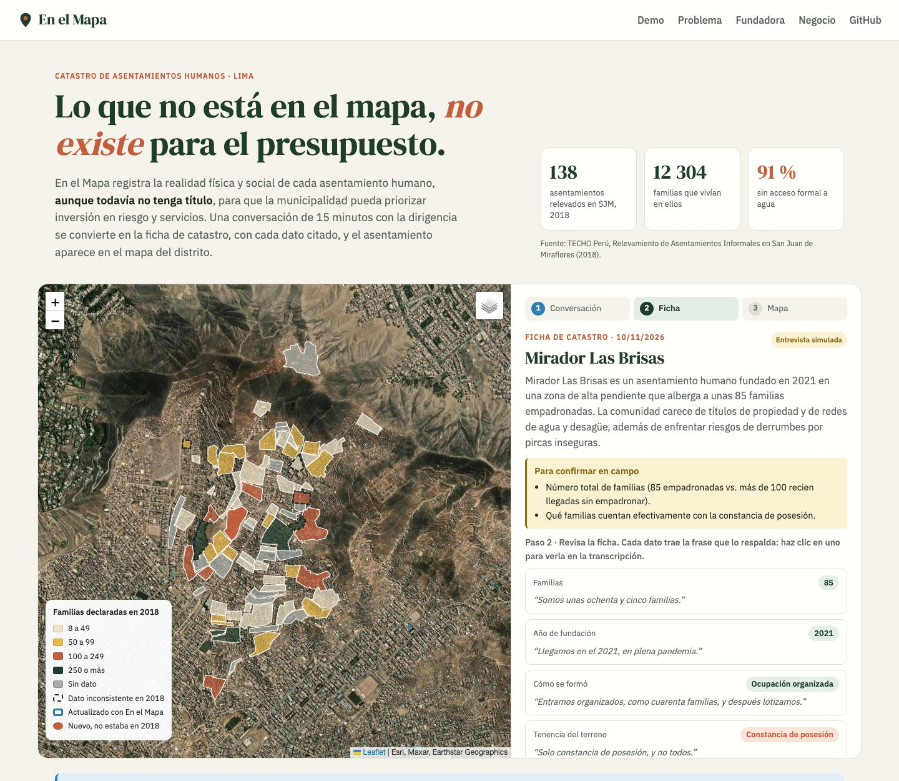
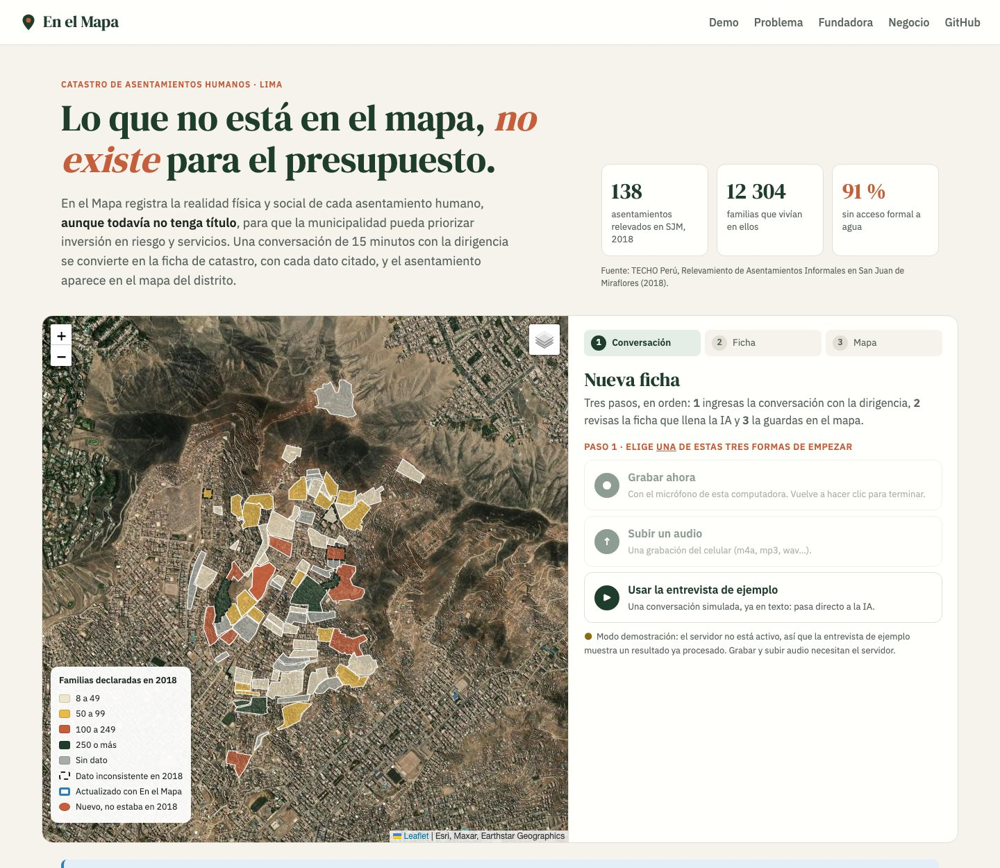
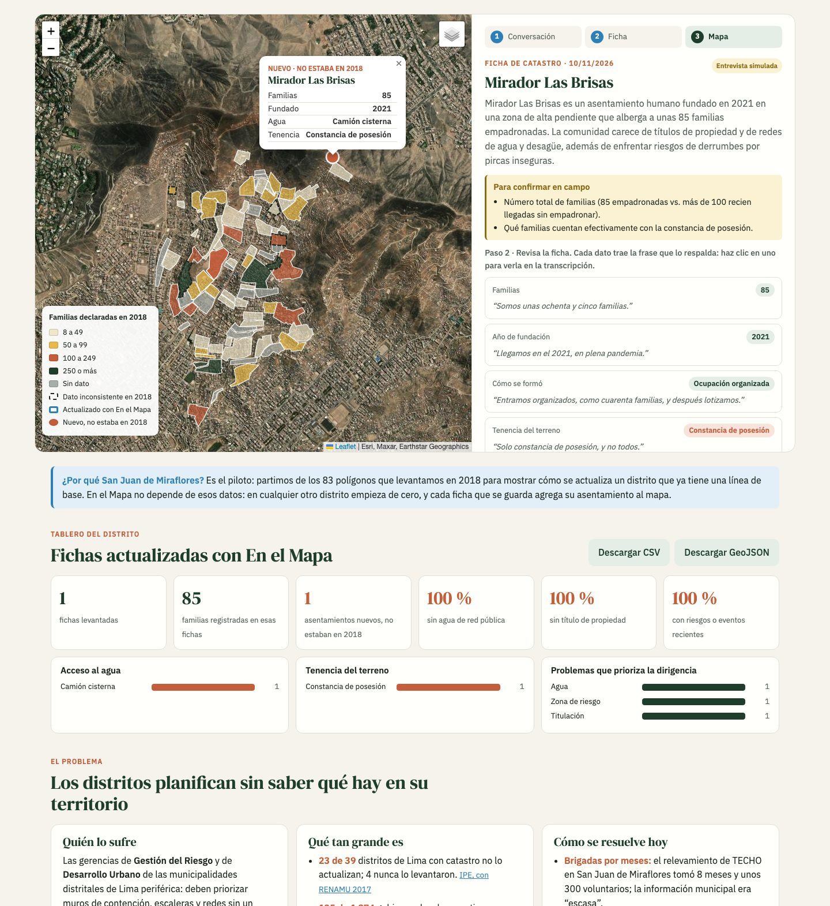

# En el Mapa

> Una conversación de 15 minutos con la dirigencia se convierte en la ficha de catastro del asentamiento, con cada dato citado, y el asentamiento aparece en el mapa del distrito.

*Borrador en construcción. Proyecto Final, Diplomatura Q-Lab PUCP, noviembre 2026.*



## 1. Fundadora

**Isabella Albarrán.** Dirigí el Relevamiento de Asentamientos Informales 2018 de TECHO Perú en San Juan de Miraflores: 8 meses de campo, unos 300 voluntarios, 138 asentamientos y 12 304 familias. Recorrí esos cerros con las dirigencias y vi dónde se rompe el dato: en la libreta, en la digitación y en los meses que pasan hasta que llega a quien decide. Los 83 polígonos de este repo vienen de ese trabajo.

Hoy me especializo en ciencia de datos para políticas públicas (Diplomado en Ciencia de Datos para las Ciencias Sociales y la Gestión Pública, Q-LAB PUCP 2026). En el Mapa es la herramienta que me hubiera gustado tener en 2018.

## 2. Problema

*(por completar: datos verificables + 3 conversaciones en [docs/research/](docs/research/))*

## 3. Solución e insight

*(por completar)*

## 4. Por qué ahora

*(por completar)*

## 5. Demo

- **Página:** *(URL de GitHub Pages, por completar)*. Sin servidor funciona en modo demostración con la entrevista de ejemplo ya procesada.
- **Flujo:** grabar o subir el audio → Whisper transcribe → Gemini llena la ficha con una cita por dato → el voluntario revisa → el asentamiento se guarda en el mapa → el tablero se actualiza y se descarga en CSV o GeoJSON.

| Mapa 2018 | Ficha citada | Mapa y tablero |
|---|---|---|
|  |  |  |

**Arquitectura**

```
navegador (docs/: HTML + Leaflet)
   │  audio (webm, m4a, mp3…)
   ▼
backend/main.py (FastAPI)
   ├─ /api/transcribir → faster-whisper "small", español, en CPU
   │                      tapa DNI y celulares antes de seguir
   └─ /api/ficha       → ai/ficha.py: Gemini con salida estructurada (Pydantic)
                          15 campos de la Ficha de Catastro de TECHO + cita literal
   ▼
mapa (polígonos 2018 + puntos nuevos) y tablero (CSV / GeoJSON)
```

**Modelos y por qué**

| Paso | Modelo | Por qué |
|---|---|---|
| Transcripción | Whisper `small` (faster-whisper, int8) | Corre en CPU sin pagar por minuto; 82 s de audio en ~6 s en una laptop. El audio no sale del servidor. |
| Ficha | Gemini `gemini-3.5-flash`, con respaldo automático a otros modelos Flash si está saturado | Salida estructurada con esquema Pydantic: los valores solo pueden ser las opciones de la ficha. Capa gratuita para el piloto. |

Prueba con la entrevista simulada (audio generado con la voz del sistema): 15 de 15 campos correctos y la contradicción sobre el número de familias marcada como "para confirmar en campo".

## 6. Modelo de negocio

*(por completar: hasta 3 planes y costo por usuario)*

## 7. Herramientas del curso

| Herramienta | Dónde está |
|---|---|
| Datos geoespaciales: GeoPandas, reproyección UTM 18S → WGS84, Folium (sesión 06) | [data/preparar_poligonos.py](data/preparar_poligonos.py), [notebooks/01_mapa_asentamientos.py](notebooks/01_mapa_asentamientos.py) |
| LLM con salida estructurada (sesión 08) | [ai/ficha.py](ai/ficha.py) |
| Whisper (sesión 13) | [backend/main.py](backend/main.py) |
| Dashboard (sesión 05) | [docs/app.js](docs/app.js), sección "Tablero" |
| Despliegue (sesión 12) | *(por completar)* |

## 8. Qué hizo el agente

*(por completar)*

## 9. Cómo correrlo

```bash
uv venv .venv --python 3.12
uv pip install --python .venv/bin/python -r requirements.txt
cp .env.example .env          # y pon tu GEMINI_API_KEY
.venv/bin/uvicorn backend.main:app --port 8000
# abrir http://localhost:8000
```

Para regenerar los datos (requiere geopandas y rapidfuzz):

```bash
python data/preparar_poligonos.py "/ruta/a/MAPA TECHO"
python data/unir_familias.py
cp data/asentamientos_sjm_2018.geojson docs/data/
```

## Por qué San Juan de Miraflores

Es el piloto. Partimos de los 83 polígonos del Relevamiento 2018 para mostrar cómo se actualiza un distrito que ya tiene línea de base. En el Mapa no depende de esos datos: en otro distrito empieza de cero y cada ficha guardada agrega su asentamiento al mapa.

## Datos y privacidad

- Polígonos y número de familias: Relevamiento 2018, TECHO Perú. Detalle en [data/README.md](data/README.md). En el Mapa no es un proyecto de TECHO.
- La entrevista de ejemplo es **simulada** y "Mirador Las Brisas" es un asentamiento ficticio.
- La ficha deja fuera los datos personales de la ficha original (nombre, DNI, celular y dirección del dirigente). Los números de DNI y de celular se tapan antes de enviar el texto al modelo.
