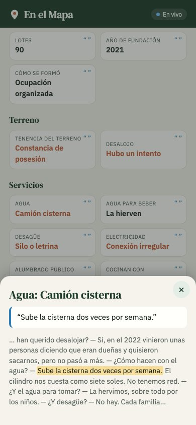
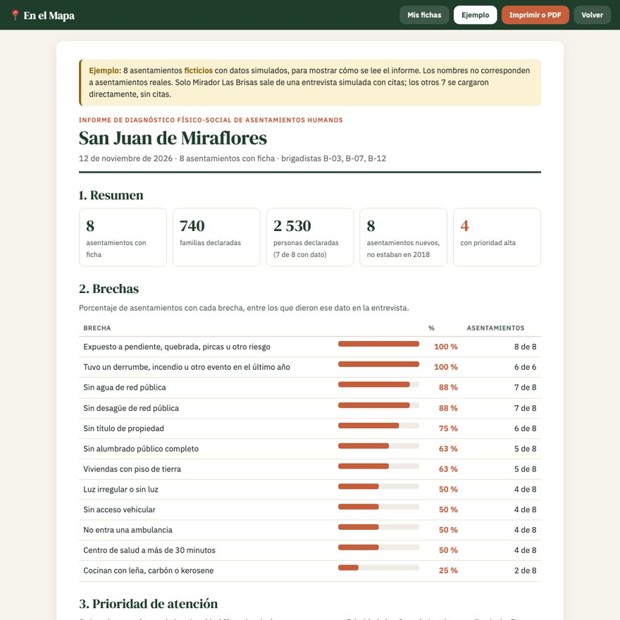

# En el Mapa

## 1. One-liner

**Hacemos el catastro físico-social de los asentamientos humanos para las municipalidades distritales de Lima mediante IA que convierte una conversación de 25 minutos con la dirigencia en una ficha citada y ubicada en el mapa, aunque el asentamiento todavía no tenga título.**

**Demo:** https://isabellaach.github.io/en-el-mapa/ · **App de la brigada:** [app.html](https://isabellaach.github.io/en-el-mapa/app.html) · Proyecto final, Diplomatura Q-Lab PUCP, noviembre 2026.



## 2. Fundadora


**Isabella Albarrán.** La idea nace de un proyecto que existió. Entre 2018 y 2019 dirigí el Relevamiento de Asentamientos Informales de TECHO Perú en San Juan de Miraflores: 8 meses de campo, unos 300 voluntarios, 138 asentamientos y 12 304 familias. Recorrí esos cerros con las dirigencias y vi dónde se rompe el dato: en la libreta, en la digitación y en los meses que pasan hasta que llega a quien decide. Fue un solo distrito, y lo que no se sabía era enorme; eso me hizo pensar en los otros distritos de Lima que también tienen asentamientos humanos. Los 83 polígonos de este repo vienen de ese trabajo. Hoy me especializo en ciencia de datos para políticas públicas (Diplomado en Ciencia de Datos para las Ciencias Sociales y la Gestión Pública, Q-LAB PUCP 2026).

<br clear="left">

**Cómo cubro cada área con agentes de IA:**

| Área | Qué hago yo | Qué hace el agente (Claude Code) |
|---|---|---|
| Producto | Defino el problema, la ficha y el flujo desde mi experiencia en campo | Propone el flujo y lo prueba de punta a punta |
| Ingeniería | Reviso y decido | Escribe el backend, la extracción con Gemini, el mapa y los scripts de datos |
| Diseño | Elijo la paleta, el tono y qué se muestra | Maqueta la página y la revisa en computadora y celular |
| Ventas | Converso con municipalidades, ONG y dirigencias | Investiga presupuestos, fuentes y competidores, y redacta los mensajes |

## 3. Problema

**Quién lo sufre.** Las subgerencias de **Gestión del Riesgo de Desastres** y de **Desarrollo Urbano** de las municipalidades distritales de Lima periférica. Tienen que priorizar muros de contención, escaleras, redes y estudios de riesgo sin un inventario actualizado de los asentamientos humanos de su distrito. Y, al final, las familias que viven en ellos y no aparecen en ningún registro.

**Qué tan grande es.**
- En Lima, 23 de 39 distritos con catastro no lo actualizan, y 4 de 43 nunca lo levantaron ([IPE, con RENAMU 2017](https://ipe.org.pe/el-catastrofico-catastro-peruano/)).
- En todo el país, solo 135 de 1 874 gobiernos locales mantienen su catastro actualizado ([La República, con RENAMU 2020](https://data.larepublica.pe/ciudades-ciegas-crecer-y-planificar-sin-saber-lo-que-hay-en-el-territorio/)).
- El 29,1 % de la población urbana de Lima vive en barrios marginales (2021) ([CEPLAN](https://observatorio.ceplan.gob.pe/ficha/ts_2_mvcs)).

**Por qué es urgente: más de una razón.**
- **Falta información:** el catastro no alcanza a los asentamientos sin título (cifras arriba).
- **La ciudad crece más rápido que el Estado:** el 93 % de la expansión urbana en las principales ciudades del Perú entre 2001 y 2018 fue informal ([GRADE, Espinoza y Fort, 2020](https://www.grade.org.pe/wp-content/uploads/EspinozaFort_GRADEADI_expansionurbana.pdf)).
- **El clima sube el riesgo:** ante un Fenómeno El Niño, 238 218 viviendas de 14 distritos de Lima quedarían en riesgo muy alto por lluvias e inundaciones ([CENEPRED 2023, en Andina](https://andina.pe/agencia/noticia-el-nino-riesgo-muy-alto-mas-230000-viviendas-lima-metropolitana-lluvias-954630.aspx)). El Niño Costero de 2017 dejó más de 1,1 millones de personas afectadas en el país ([OPS, con SINPAD](https://www.paho.org/es/peru/emergencia-por-impacto-fenomeno-nino-costero-peru-2017)).
- **El golpe cae sobre los más vulnerables:** las familias de los asentamientos, con viviendas precarias y sin servicios formales.

Quién gana: las **familias** aparecen en el registro y entran en la priorización de obras y de prevención; las **dirigencias** tienen la ficha de su asentamiento para sus trámites; las **autoridades locales** deciden dónde invertir con datos actuales y verificables.

**Cuánto les cuesta.** En tiempo y gente: el relevamiento de TECHO en un solo distrito tomó **8 meses y unos 300 voluntarios**, y la información que tenía la municipalidad era "escasa" ([informe del relevamiento](https://peru.techo.org/wp-content/uploads/sites/18/2021/12/InformeRelevamientoFINAL.pdf)). En errores: en la base de 2018, 5 de los 63 asentamientos que pudimos cruzar tienen un número de familias que contradice el rango declarado en la misma ficha (por ejemplo, "250 a 499 familias" con un número exacto de 30).

**Cómo lo resuelven hoy, sin nosotros.**
1. Brigadas con fichas en papel o en Kobo y semanas de digitación.
2. Una consultoría por cada estudio. Por ejemplo, la evaluación de riesgo y el muro para el AA.HH. Minas 2000 ([términos de referencia de PREDES, 2024](https://predes.org.pe/wp-content/uploads/2024/02/TdR-Elaboracion-de-expediente-Proyecto-Minas-2000-F.pdf)), un asentamiento que está en nuestro mapa.
3. No se hace: lo que no tiene título no entra al catastro.

**Evidencia: conversaciones con usuarios.** Notas completas en [docs/research/conversaciones.md](docs/research/conversaciones.md), con tres perfiles: funcionario municipal de Desarrollo Urbano, trabajador de ONG con trabajo territorial (TECHO) y especialista en Gestión del Riesgo. Lo principal:
- La información municipal existe, pero está dispersa entre Desarrollo Urbano, Catastro y Gestión del Riesgo, y hay que volver a verificarla.
- El presupuesto podría salir del PP 0068, y sería más viable empezar con un piloto chico. Por eso existe el piloto de 15 asentamientos.
- El miedo principal es que la IA invente datos. Por eso cada dato lleva su cita y lo dudoso queda "por verificar".
- Piden exportar a Excel y GIS, trabajar desde el celular y, si se puede, sin conexión.
- Una ficha no reemplaza una evaluación oficial de riesgo: es un insumo para ella.

## 4. Solución e insight

**Qué construimos.** Tres piezas, una para cada usuario:

1. **La app de la brigada** ([docs/app.html](docs/app.html)), para el celular e instalable como app. El brigadista entra con su código (no su nombre), graba la conversación con la dirigencia o sube el audio, y sigue tres pasos con Atrás y Siguiente. Whisper transcribe; Gemini llena **28 campos de la Ficha de Catastro de TECHO** (población, terreno, servicios, vivienda, riesgo y acceso de emergencias, comunidad y distancia a servicios) con salida estructurada y, para cada dato, copia la frase literal que lo respalda. El brigadista revisa (al tocar un dato ve su cita en la conversación), marca lo que observa en campo (estado de techos, paredes y pisos) y guarda el asentamiento en el mapa: en su polígono de 2018 o, si es nuevo, con un toque en el mapa. La ficha en curso se guarda como borrador. Lleva la guía de entrevista impresa ([docs/guia.html](docs/guia.html)).
2. **Para la junta directiva:** la ficha de su asentamiento, para compartir por WhatsApp o imprimir en PDF ([docs/ficha.html](docs/ficha.html)), con cada dato y su cita.
3. **Para la municipalidad:** el tablero del distrito (CSV y GeoJSON para su GIS) y el **informe del distrito** ([docs/informe.html](docs/informe.html)): 12 brechas, prioridad de atención por asentamiento (alta, media o baja), mapa, pendientes por confirmar y límites del método.

La página ([docs/index.html](docs/index.html)) presenta el problema, el demo, el flujo y el modelo de negocio.

**Qué pasa con la información.** (1) La brigada o el voluntariado conversa, graba y revisa desde cualquier celular con navegador. (2) La junta directiva recibe la ficha de su asentamiento. (3) La municipalidad (Gestión del Riesgo y Desarrollo Urbano) ve el tablero y descarga CSV para Excel e informes, y GeoJSON para QGIS o ArcGIS, para estudios de estimación del riesgo, priorización de obras y el plan urbano. En la demo las fichas se guardan en el navegador; en el servicio, cada distrito tiene una base compartida.

**Insight.** La dirigencia ya tiene la información; lo que falta es convertirla en dato verificable, **sin esperar al título**. El catastro puede inventariar la realidad física y social de un asentamiento aunque no tenga saneamiento legal. Separar ese registro de la titulación permite que la municipalidad actúe ya. Y la cita por dato resuelve el problema de confianza: cualquiera puede auditar de dónde salió cada respuesta.

## 5. Por qué ahora

- **La IA ya lo hace por centavos.** Hace tres años, transcribir español coloquial en una laptop y llenar un formulario con valores controlados exigía modelos caros o entrenados a mano. Hoy Whisper corre en CPU y los LLM devuelven JSON que valida contra un esquema.
- **Hay presupuesto con nombre propio.** El 82,8 % de las municipalidades distritales asignó recursos al Programa Presupuestal 0068 de reducción del riesgo de desastres ([Defensoría del Pueblo, 2022](https://www.defensoria.gob.pe/wp-content/uploads/2022/04/Reporte-002-2022-Programa-Presupuestal-0068.pdf)), que financia estudios de estimación del riesgo.
- **Gestiones nuevas.** Las autoridades municipales elegidas en 2026 asumen en enero de 2027 y necesitan su diagnóstico de territorio.

## 6. Demo

- **Página:** https://isabellaach.github.io/en-el-mapa/
- **App de la brigada:** https://isabellaach.github.io/en-el-mapa/app.html (en el celular: Instalar app o Agregar a inicio)
- **Informe del distrito, ejemplo:** https://isabellaach.github.io/en-el-mapa/informe.html?ejemplo=1 (8 asentamientos ficticios con datos simulados)
- **Ficha para la junta, ejemplo:** https://isabellaach.github.io/en-el-mapa/ficha.html?id=ej-0&ejemplo=1
- **Guía de entrevista para imprimir:** https://isabellaach.github.io/en-el-mapa/guia.html
- Publicado sin servidor, funciona en **modo demostración**: la entrevista de ejemplo muestra un resultado ya procesado. El **flujo completo en vivo** (grabar o subir audio, Whisper y Gemini) corre con el servidor en local; ver [Cómo correrlo](#cómo-correrlo).
- **Video de respaldo:** pendiente.

| 1. Nueva ficha | 2. Cada dato con su cita | 3. Informe del distrito |
|---|---|---|
|  |  |  |

**Arquitectura**

```
celular de la brigada (docs/app.html + movil.js)      página (docs/index.html + app.js)
          │  audio (webm, m4a, mp3…)                          │
          └──────────────┬────────────────────────────────────┘
                         │   lógica compartida: docs/comun.js
                         ▼
backend/main.py (FastAPI)
   ├─ /api/transcribir → faster-whisper "small", español, en CPU
   │                      tapa DNI y celulares antes de seguir
   └─ /api/ficha       → ai/ficha.py: Gemini con salida estructurada (Pydantic)
                          28 campos de la Ficha de Catastro de TECHO + cita literal
                          (si un modelo está saturado, pasa a otro Flash)
                         ▼
fichas guardadas en el navegador (código de brigadista, observación en campo)
   ├─ mapa (polígonos 2018 + puntos nuevos) y tablero → CSV / GeoJSON
   ├─ ficha para la junta (docs/ficha.html) → compartir o PDF
   └─ informe del distrito (docs/informe.html + reportes.js) → brechas, prioridad, mapa, PDF
```

**Modelos y por qué**

| Paso | Modelo | Por qué |
|---|---|---|
| Transcripción | Whisper `small` (faster-whisper, int8) | Corre en CPU sin pagar por minuto: 82 s de audio en unos 8 s en una laptop. El audio de la conversación no sale del servidor. |
| Ficha | Gemini `gemini-3.5-flash`, con respaldo automático a otros modelos Flash si está saturado | Salida estructurada con esquema Pydantic: cada campo solo acepta las opciones de la ficha, y cada dato exige su cita. Con razonamiento "low" responde en unos 5 a 7 s en vez de 13 a 15 s, con la misma ficha (en la prueba con la ficha de 15 campos: 15 de 15, las mismas contradicciones y citas literales); sin razonamiento perdía una contradicción. Capa gratuita para el piloto. |

Prueba con la entrevista simulada ampliada (en texto): 28 de 28 campos correctos, y quedaron "para confirmar en campo" el número de familias y la seguridad de las pircas. Con la versión anterior en audio (voz del sistema), 15 de 15. De punta a punta, 82 s de audio se convierten en ficha en unos 15 s. Además, el brigadista marca en la app el estado de techos, paredes y pisos que observa en campo (no sale de la conversación).

## 7. Modelo de negocio

**Quién paga:** la municipalidad distrital, con el presupuesto que ya tiene para estudios de estimación del riesgo. No vendemos solo software: entregamos el diagnóstico hecho ("X hecho por IA").

| Plan | Para quién | Precio | Qué incluye |
|---|---|---|---|
| Comunidad | Juntas directivas | Gratis | La junta levanta y descarga la ficha de su asentamiento. Es el canal de entrada a cada barrio. |
| Organización | ONG y cooperación | S/ 250 al mes | Hasta 40 fichas al mes, mapa compartido, CSV y GeoJSON |
| **Distrito** | **Municipalidades distritales** | **S/ 22 500 por diagnóstico** (precio de lanzamiento; lista: S/ 25 000) | Hasta 150 asentamientos en 6 semanas, fichas citadas, capas GIS e informe de brechas. Piloto para empezar: 15 asentamientos por S/ 4 500. Actualización anual: S/ 6 000 |

**Cuánto nos cuesta (margen de contribución)**

- **IA por ficha:** Gemini procesa unas 6 000 palabras de entrada (transcripción de 25 min, instrucciones y esquema) y unas 1 500 de salida: menos de S/ 0,10 (estimado con la capa paga de Gemini Flash). Whisper corre en nuestro servidor: casi S/ 0.
- **Plan Organización:** 40 fichas cuestan unos S/ 44 en IA y servidor; margen de contribución de unos S/ 206 al mes (82 %).
- **Plan Distrito, presupuesto preliminar de un diagnóstico de 150 asentamientos:**

| Concepto | Costo |
|---|---|
| Coordinación y gestión | S/ 3 000 |
| Trabajo de campo y entrevistas | S/ 4 000 |
| Tecnología: IA y servidor | S/ 1 000 |
| Procesamiento y georreferenciación | S/ 3 000 |
| Validación y control de calidad | S/ 2 000 |
| Informe | S/ 2 000 |
| Transporte y otros | S/ 1 000 |
| **Total** (≈ S/ 107 por asentamiento) | **S/ 16 000** |

Se vende en S/ 22 500: margen de S/ 6 500 (29 %) antes de impuestos. Casi todo el costo es trabajo de personas, no IA.

**Referencias de precio.** [Solidaridad Latam (2026)](https://solidaridadlatam.org/oro/consultoria-ejecucion-de-instrumentos-y-levantamiento-de-informacion-en-zonas-mineras-de-arequipa-y-ayacucho/): presupuesto de hasta S/ 25 000 por al menos 200 encuestas en cuatro centros poblados, con campo y sistematización (S/ 125 por encuesta; nosotros, S/ 150 por asentamiento). TECHO (2018): el relevamiento de San Juan de Miraflores contó con US$ 20 000 de financiamiento privado, que cubrió el relevamiento y parte de la operación. Software de formularios como Fulcrum u ODK Cloud cobra por usuario o por mes, pero no entrega un diagnóstico terminado. Al estar por debajo de 8 UIT, el plan Distrito puede contratarse como [contrato menor](https://www.gob.pe/70088-gestionar-contratos-menores) (Ley 32069).

**Supuestos por validar:** los precios son una hipótesis sustentada en esas referencias y en un primer presupuesto, no tarifas validadas. Asumen que la municipalidad facilita el contacto con las dirigencias. Falta medir cuánto demora de verdad cada entrevista y cada validación antes de comprometer 150 asentamientos en 6 semanas.

## 8. Herramientas del curso

| Herramienta | Para qué la usamos | Dónde está |
|---|---|---|
| Whisper, de voz a texto (sesión 13) | Transcribir la conversación con la dirigencia en español, en el servidor | [backend/main.py](backend/main.py) |
| LLM con salida estructurada (sesión 08) | Llenar la ficha con valores controlados y una cita por dato | [ai/ficha.py](ai/ficha.py) |
| Datos geoespaciales y mapas (sesión 06) | Reproyectar los shapefiles de UTM 18S a WGS84, calcular áreas, unir la base de 2018 y dibujar el mapa | [data/preparar_poligonos.py](data/preparar_poligonos.py), [data/unir_familias.py](data/unir_familias.py), [notebooks/01_mapa_asentamientos.py](notebooks/01_mapa_asentamientos.py), [docs/app.js](docs/app.js), [docs/movil.js](docs/movil.js), mapa del informe en [docs/reportes.js](docs/reportes.js) |
| Dashboard (sesión 05) | Tablero del distrito con indicadores y descargas; informe del distrito con brechas y prioridades | [docs/comun.js](docs/comun.js) (`tableroHTML`, `BRECHAS`), [docs/reportes.js](docs/reportes.js) |
| Despliegue (sesión 12) | Página y app instalable (manifest) en GitHub Pages; API en FastAPI | [docs/](docs/), [docs/manifest.webmanifest](docs/manifest.webmanifest), [backend/main.py](backend/main.py) |

**Por qué estas:** el insumo del trabajo de campo es una conversación (Whisper), el producto es una ficha estándar que debe ser auditable (salida estructurada con citas) y el cliente decide por territorio (mapa y tablero).

## 9. Qué hizo el agente

Usé Claude Code durante todo el proyecto. Yo definí el problema, aporté los datos (los polígonos, la base y la Ficha de Catastro del relevamiento de 2018), tomé las decisiones de producto y diseño y revisé cada paso antes de aprobarlo. El agente:

- Buscó y verificó las fuentes del problema y del modelo de negocio (RENAMU, CEPLAN, Defensoría, PREDES) y leyó el informe del relevamiento.
- Escribió los scripts de datos: la conversión de los shapefiles, la corrección de nombres y el emparejamiento de nombres con la base de 2018 (normalización, similitud de texto y pares revisados a mano).
- Escribió el backend ([backend/main.py](backend/main.py)), el esquema y el prompt de la ficha ([ai/ficha.py](ai/ficha.py)) y la página completa ([docs/](docs/)).
- Escribió la entrevista simulada de ejemplo, probó el flujo de punta a punta, tomó las capturas y redactó este README para mi revisión.
- Después de la presentación, con mis pedidos: arregló los errores de audio (grabación vacía, sin voz, permisos) y agregó Reintentar; midió Whisper y Gemini y redujo el razonamiento de Gemini, que era el cuello de botella (de 25 a 40 s a unos 15 s de punta a punta); construyó la app del celular (inicio, código de brigadista, Atrás y Siguiente, borrador, compartir), amplió la ficha a 28 campos con la observación en campo, reordenó la página y creó el informe del distrito y la ficha para la junta, con un ejemplo de asentamientos ficticios ([data/informe_ejemplo.py](data/informe_ejemplo.py)).
- Las notas de las tres conversaciones con usuarios son mías; el agente solo las ordenó.

## Cómo correrlo

```bash
uv venv .venv --python 3.12
uv pip install --python .venv/bin/python -r requirements.txt
cp .env.example .env          # y pon tu GEMINI_API_KEY
.venv/bin/uvicorn backend.main:app --port 8000
# página: http://localhost:8000 · app: http://localhost:8000/app.html
```

Para regenerar el ejemplo del informe (8 asentamientos ficticios): `python data/informe_ejemplo.py`.

Para regenerar los datos (requiere geopandas y rapidfuzz):

```bash
python data/preparar_poligonos.py "/ruta/a/MAPA TECHO"
python data/unir_familias.py
cp data/asentamientos_sjm_2018.geojson docs/data/
```

## Por qué San Juan de Miraflores

Es el piloto. Partimos de los 83 polígonos del Relevamiento 2018 para mostrar cómo se actualiza un distrito que ya tiene línea de base. En el Mapa no depende de esos datos: en otro distrito empieza de cero y cada ficha guardada agrega su asentamiento al mapa.

## Próximos pasos

- Dibujar el polígono de un asentamiento nuevo directamente en el mapa (hoy se guarda como punto).
- Guardar las fichas en una base de datos compartida por distrito (hoy se guardan en el navegador) y, con ella, cuentas con roles: brigadista, supervisión y municipalidad.
- Publicar el servidor (Whisper y Gemini) para que el enlace público funcione en vivo, sin la laptop.
- Medir en campo cuánto dura de verdad cada entrevista y cada validación, para ajustar los costos.
- Detectar asentamientos nuevos con imágenes satelitales para saber dónde enviar a las brigadas.
- Una versión que trabaje sin conexión en zonas sin señal (hoy se graba con el celular y se sube después).

## Preguntas frecuentes

Están en la sección [Preguntas](https://isabellaach.github.io/en-el-mapa/#preguntas) de la página: si promueve la ocupación informal (no: registrar no es formalizar), si funciona en celular y sin señal, cuánta capacitación necesita, qué tan confiable es la IA, qué pasa con los datos personales, en qué se diferencia de COFOPRI y del catastro municipal, y por qué pagaría una municipalidad.

## Datos y privacidad

- Polígonos y número de familias: Relevamiento 2018, TECHO Perú. Los datos se publicaron para el uso de quien los necesitara y se usan con autorización de TECHO. Detalle en [data/README.md](data/README.md). En el Mapa no es un proyecto de TECHO.
- La entrevista de ejemplo es **simulada** y "Mirador Las Brisas" es un asentamiento ficticio. El ejemplo del informe usa 8 asentamientos **ficticios** con datos simulados; ningún nombre coincide con un asentamiento real de 2018.
- Cada ficha registra el **código** del brigadista, no su nombre.
- La ficha deja fuera los datos personales de la ficha original (nombre, DNI, celular y dirección del dirigente). Los números de DNI y de celular se tapan antes de enviar el texto al modelo.
